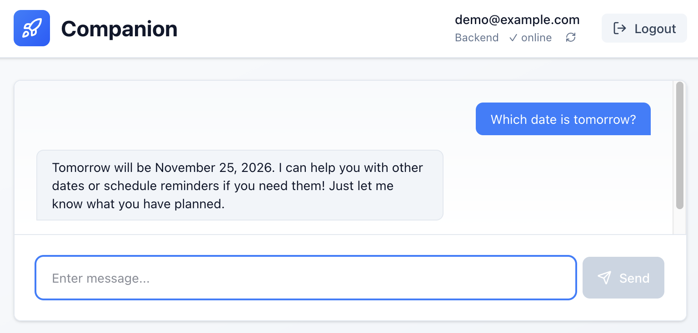

<div align="center">

# Companion

<!-- Badges -->
[](https://opensource.org/licenses/MIT)
[](https://www.php.net/)
[](https://phpstan.org/)
[](https://www.docker.com/)

[](https://codecov.io/gh/makomweb/companion)

A production-ready full-stack application scaffold combining **Symfony 8.1** backend + **React 18** frontend + **Docker** containerization, and comprehensive quality assurance which can be used as a project template. 🚀

Includes [**Neuron AI**](https://docs.neuron-ai.dev/) 🔗 integration for real-time LLM-powered conversations with tool execution capabilities, enabling intelligent chat features backed by your backend logic.



</div>

## Quick Start

```bash
make boot    # Setup everything
make up      # Start services
make down    # Stop services
```

**URLs:**
- Frontend: http://localhost:5173
- Backend: http://localhost:8080/api/health
- Database UI: http://localhost:8085 (user: root, pwd: secret)

## Common Commands

```bash
make shell            # Access backend container
make test             # Run tests
make qa               # Full quality checks
make help             # Show all commands
```

**Documentation:** See [`docs/`](./docs/INDEX.md)
